# Lathe Shop System Analysis

Source: `SA Project (1).md`, supplied on 2026-10-29. This is a concise, implementation-aware digest of the report, not a replacement for the detailed frontend, backend, or API contracts.

## Purpose and problem statement

The system supports a small made-to-order lathe shop producing custom metal parts for individual and company customers. The original report identifies manual quotation work, poor visibility of job queues and deadlines, weak stock tracking, and difficulty following deliveries and balances. The intended system connects customer requests, quotations, procurement, inventory, production, delivery, and payment history.

## Actors

| Actor | System responsibility |
| --- | --- |
| Customer | Register, create and track requests, review quotations, submit required PO/deposit evidence, inspect delivery, and submit payment evidence. Company permissions follow active membership. |
| Worker (shown as Staff in parts of the UI) | Review requests, create quotations, work with material plans, receive materials, execute jobs, issue invoices/shipments, and review fulfillment evidence where authorized. |
| Admin | Manage staff, material catalog and stock, procurement, supplier settlement, production cost, invoice terms, cash receipts, and evidence review according to the backend permissions. |
| Supplier | External business party for purchasing and replacement claims. Suppliers do not sign in to this application. |
| API/worker processes | Enforce business rules, persist audit/state changes, store notifications in the outbox, and dispatch them after commit. |

## Current business flow

```mermaid
flowchart LR
  A[Customer request and files] --> B[Worker reviews request]
  B --> C[Quotation and cost estimate]
  C --> D{Customer decision}
  D -->|Reject| C
  D -->|Accept| E[PO and/or deposit evidence]
  E --> F[Staff review]
  F -->|Requirements approved| G[Queued job]
  G --> H[Material plan and reservations]
  H --> I[Admin orders materials if needed]
  I --> J[Staff receives materials]
  J --> K[Worker records actual production]
  K --> L[Delivery and invoice]
  L --> M[Customer accepts or returns for free rework]
  M -->|Return| K
  M -->|Accept and fully paid| N[Request closed]
```

The diagram is a current-flow summary. The source report's embedded images and legacy process variants are intentionally not copied as opaque base64 into this repository.

## Confirmed rules reflected by the current contracts

- The minimum quotation price applies a 60% markup to material plus labor cost for the whole requested quantity; monetary arithmetic is exact and VAT is not added.
- The sixth distinct quotation rejection cancels the request; five rejections allow a revision.
- Accepted terms require PO and/or deposit according to customer type and price. The deadline is 14 days after quotation acceptance.
- Evidence is stored in private object storage. The database stores object keys and metadata, not public file URLs. Signed links are temporary and authorized.
- A job opens only after required fulfillment evidence is approved. A reservation is not material consumption; actual use and remaining reservations are reconciled separately.
- Supplier accounts are not supported. Procurement is Admin-only; receiving may be done by Admin or Worker, with supplier financial information limited to Admin.
- Customer requests are scoped by the authenticated customer or active company membership. The browser never falls back to mock data when the API fails.

For exact rules and exceptions, see `docs/014-use-case-index.md` and the backend UC documents. They supersede incompatible wording in the academic report.

## Stack and documentation boundaries

- Frontend: Next.js/React/TypeScript; the configured backend API is the source of workflow state.
- Backend: Go with chi and PostgreSQL; business logic and authorization remain server-side.
- Files: private S3-compatible object storage; only object metadata/key is persisted in PostgreSQL.
- Detailed UI and integration contract: `docs/02-frontend.md` and `docs/real-api-only.md`. `docs/11-phase-ten-handoff.md` is a historical implementation snapshot.
- Current backend demo workflow fixture setup and scenarios: `SA-Lathe-Shop-BE/docs/017-demo-workflows.md`. That optional fixture supersedes older account-only-seed notes wherever those notes imply the demo database can never contain workflow records.

## Source precedence

Use the following order when documents disagree: current backend UC/API contract and owner-confirmed decisions; current frontend integration documentation for presentation and client behavior; then the supplied academic report as historical analysis/design context. The report's entity names, SQL examples, status diagrams, and embedded UI designs are not directly executable API or database contracts.
