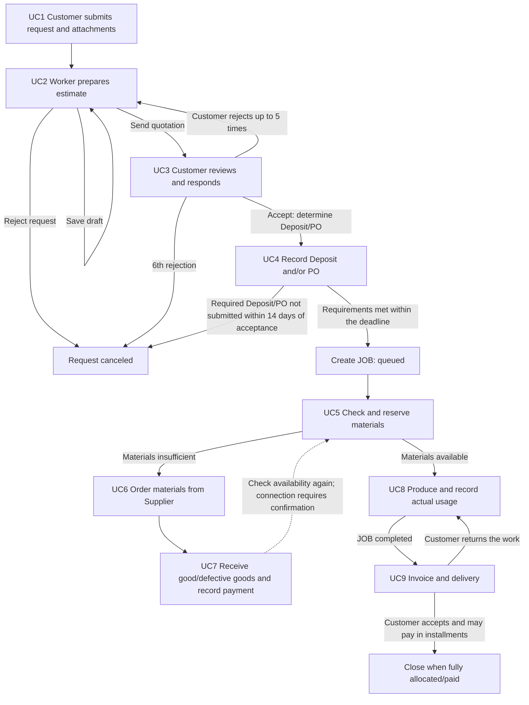

# Machine Shop Custom Manufacturing System — Frontend Guide

## Current access: real API only — 2026-10-28

The owner requested complete browser-mock removal. Login, registration and all
workspaces now use the real API only. Sample accounts, in-browser fixture routes,
reset/account-switch/lost-response controls and mock private-object resolution
are removed. Memory-only Bearer sessions, logout/expiry, role boundaries and live
empty/error states are unchanged. Historical prototype/mock descriptions below
are retained as history, not instructions to restore a demo bypass.

Use `NEXT_PUBLIC_API_BASE_URL` (public API origin only). Real seeded demo accounts
require an operator-prepared dedicated database and private passwords; no real
password belongs in frontend source/config. Account-only seeds contain no
workflows, so initial empty lists are expected. See `real-api-only.md` for scope
and verification; real-account browser testing is not implied by unit tests.

## Customer wireframe implementation — 2026-10-27

The owner approved replacing all authenticated Customer screens with the Thai,
mobile-first wireframes. The implementation is isolated in `src/features/customer/`;
Staff/Admin, Landing and Login/Register are preserved. Existing route files remain;
jobs and payments aliases now render their own workspaces. Request/quotation/job
detail and wizard states use UUID query selectors on existing routes. Customer
data comes only from existing authorized endpoints, with explicit incomplete-read
labels and no live-to-mock fallback. The bell uses current personal inbox reads and
per-item read commands; unread reversal/typed event targets remain gaps, not fake APIs.

Business rules and exact money/int64 handling are unchanged. UC4 file upload is not
evidence approval, Job opening or money verification. UC9 supports installments,
independent receipt/payment order, and same-job free rework before acceptance.
See `docs/customer-redesign-handoff.md` for coverage and verification limitations.

## Source organization update — 2026-10-27

App Router routes remain under `app/`; non-route code is organized under `src/features/`,
`src/components/`, `src/hooks/` and `src/lib/`. The explicit contract mock lives under
`src/mocks/` (core transport, fictional data, and domain route modules). Native tests
mirror these owners under `tests/`; run `npm test`. Historical source paths below
describe their original phase; current workflows and backend contracts are unchanged.

## Public landing update — 2026-10-27

The owner approved the cinematic landing on `codex/cinematic-scrap-landing`, branched from `develop`, then replaced its animation with a five-second robotic pickup → conveyor → furnace → finished ingot loop. The latest refinement adds mechanical detail, brushed surfaces and soft shadows, translates the public page to Thai, and removes the visible playback bar. This remains an illustrative metaphor, not a recycling-service claim or a new business process. Auth routes, API contracts, role screens, and UC1–UC9 remain unchanged. Workspace language/settings remain unchanged.

Previously approved dependencies remain: `three`, React-19-compatible `@react-three/fiber` major9, `gsap`, and development `@types/three`; no dependency was added. Noto Sans Thai uses existing Next/font self-hosting and is scoped to the landing. `src/features/landing/landing-config.ts` holds Thai copy; `src/features/landing/process-config.ts` holds five durations, easings, loop default and render budgets. Geometry and shared brushed textures are procedural; no supplied `.glb` is needed. Final-frame WebPs provide reduced-motion/failed-WebGL fallback. Tap/click or keyboard-activate the illustration to pause/resume, with no visible action bar. Read `docs/landing-handoff.md` for source ownership, run instructions, provenance and actual verification limits. This supersedes historical animation descriptions, not business workflows.

## Current integration contract — Phase 10 (2026-10-25)

This supersedes the Phase 9 scope below. The designed shell now runs on the real API client for AUTH and UC1–UC9, against backend `docs/UC1.md`–`UC9.md` and the Go DTOs at backend `develop` (UC9 `028dd88` and later). The fixture demo was removed. See `docs/11-phase-ten-handoff.md` for setup, mock accounts, the real-backend checklist and verification evidence.

- Owner decisions (2026-10-24): `DESIGN.md` is the visual source; finish the frontend before database/system integration; one designed shell for live and test use; test accounts sign into an in-browser **contract mock** (explicit opt-in, never a fallback for live failures, no new config key); routes follow the backend's confirmed permissions (new Admin requests/materials/receiving/production/delivery-payment, Inbox for all roles, Customer memberships; Staff orders → receiving).
- UC6 (Admin only): suppliers (optional plain email, 7–15 digit phone, versioned full replacement, no delete) and immutable supplier orders with exact six-place quantity/unit cost, half-up per-line THB totals, optional Asia/Bangkok expected time and job references; accept (optional note), reject/cancel (reason) per the UC6 state table.
- UC7 (Staff + Admin): accepted orders, exact good/damaged receipts, replacement rows bounded by what the claim still owes, required supplier-contact note. Admin only: credit days once (0–36,500, no default), one full bank (proof required) or cash (proof optional) settlement after full receipt. Staff never receive finance fields.
- UC8 (Staff act, Admin monitors): start only when the saved plan is nonempty and fully reserved at the current plan version; incremental actual use (own reservation first, extra/unplanned allowed from free stock); whole labor minutes; optional private JPEG/PNG photos; completion releases unused reservations without adding stock. Admin enters/revises actual labor cost; valuation/costs are Admin-only.
- UC9: Admin credit days once; Staff/Admin issue the fixed invoice (job balance) and record whole-job shipments (self/third-party, receiver); scoped Customers accept (final) or return with a reason (same job reopens for free rework, invoice unchanged) and submit bank proof for amounts up to the balance; Admin records cash and approves/rejects proofs. Request closes only when the latest delivery is accepted and the invoice is fully paid. Staff never receive payments.
- All UC6–UC9 commands send a UUID idempotency key and the current expected version; uncertain failures freeze the original key/payload for an explicit identical retry or a discard-and-reload, never automatic retry. Same-record reloads keep the last data visible; action forms render only from settled data.
- Verification: 44 native tests and TypeScript pass; headless-Chrome checks against the mock pass for every role and UC flow. Update 2026-10-26: owner-approved Next.js 16.4.3 security upgrade (with matching eslint-config-next) makes `next build` pass and ESLint run (only the pre-existing appearance.tsx finding remains). Deployment for student testing: Vercel (frontend) + Railway (backend), see `docs/12-deploy-vercel-railway.md`. Real Go/PostgreSQL/S3 verification remains pending until the Railway deployment is exercised.

## Historical integration contract — Phase 9 (2026-10-23)

This supersedes historical scope statements below. Connected frontend implements AUTH and UC1–UC5, using backend `028dd88` and verified UC5 handler/service/PostgreSQL/role-filtered DTOs. Backend UC1–UC9 exists; frontend UC6–UC9 is still demo-only. Full-stack frontend UC4/UC5 verification remains pending Docker recovery. Exact setup/coverage: `docs/10-phase-nine-handoff.md`.

- Existing `/login`/`/register`, memory-only sessions and separate demo role routes are unchanged. Staff (`worker`)/Admin get a connected Materials tab; Customers never mount/fetch inventory or job plans. No new routes, dependencies, folders or backend edits.
- Literal case-insensitive material-name search uses `GET /materials?search=...&limit=20&offset=...`, with `{items}` only. Display ID/name/fixed unit/active state and exact six-place on-hand/reserved/available quantities. Worker responses and UI exclude average/movement costs and private reasons. No float arithmetic or fixture fallback.
- Admin creates units/materials, renames and activates/deactivates materials with expected version. Unit is immutable; no destructive delete/conversion. Names are trimmed, case-insensitive unique, up to 50/200 Unicode characters, without NUL/CR/LF. Unit listing is capped at 1,000. Reload before repeating uncertain non-idempotent catalog writes.
- Admin stock `addition`: active material, positive quantity, nonnegative unit cost, reason. `correction`: absolute counted quantity, including inactive material, no unit cost; cannot go below reservations and preserves average cost. Reason is required, up to 2,000 Unicode characters. Quantity/cost use exact NUMERIC(18,6) strings: 12 whole digits/six decimals, no negative/exponent/rounding. This is administrative stock, not supplier receiving/payment.
- Plans appear under the server-returned UC4 job in an approved quotation. Admin reads; Worker writes only an ongoing request's queued job. Plan returns material IDs and required/reserved/consumed/shortage/readiness/version, not names/units. Preserve existing unknown/inactive IDs; catalog search is not a complete inventory. No invented general jobs list.
- Saving sends a complete explicit list of up to 500 distinct positive-quantity materials. Confirm explicit `[]` to release all reservations. Removed/reduced lines release excess; new/increased inactive requirements are denied. Server allocates partial available stock and protects other jobs; reservation is not physical consumption/costing. Initial plan version is 0, material version starts at 1.
- Recheck explicitly tops up the saved plan, not unsaved edits. New stock never automatically replenishes reservations. Backend revalidates status/access on every write. Stock/plan uncertain retries preserve original UUID key/canonical payload/expected version in memory with frozen fields. Never auto-retry or change payload under a key; GET current state after replay, since replay snapshots may be old. Inspect current state after leaving/reloading before a new intent. Conflicts require reload, never overwrite.
- Verification: 58 native tests, TypeScript and targeted lint pass; contract-stubbed browser checks cover catalog, exact stock/plan retry, shortage/top-up/release/conflict recovery, permissions and responsive display. These are not Go/PostgreSQL/storage verification. Build compilation/type-check/prerender completes but exits 1 on a repeated Next.js security-upgrade gate. No dependency upgrade authorized/performed. Full lint still has the existing appearance.tsx effect error/warning.

## Historical integration contract — Phase 8 (2026-10-19)

This section supersedes Phase 7 scope/gap statements below. Frontend now connects the backend's Worker-contact follow-up and UC4, against backend `docs/AUTH.md` and `docs/UC4.md` at `ab0c224`. The newer remote UI design was merged without replacing it: `/` remains Landing, `/login` and `/register` provide real auth, and separate role URLs remain the local demo. See `DESIGN.md` for current visuals and `docs/09-phase-eight-handoff.md` for setup, coverage and known verification limits.

- Admin → Workers supports real create/edit, required name/email/phone, existing username/employee number and optional position, password change and active-state controls. Email is case-preserving and server-validated with net/mail, maximum 254 bytes. Phone accepts optional +, 7–15 digits with permitted display separators, maximum raw 64 bytes; the server returns normalized digits. Contacts are non-unique and not login identifiers. Legacy nulls show "Not provided (legacy account)"; edits may backfill them without fabricated data or account deactivation. No delete/promotion action.
- UC4 appears under an **approved quotation** in connected Requests, not in a demo Deposit/PO panel. Scoped Customers/company members upload a new private file, wait for ready validation, then submit explicit deposit/PO evidence. One deposit may be the rounded minimum through the full quote total (zero-price contracts allow zero confirmation). Deposit includes decimal-string amount and declared nonfuture `paid_at`, entered in Asia/Bangkok; PO omits both fields. File allowlist/100 MB/private-link rules remain unchanged.
- The original accepted terms and 336-hour deadline remain immutable. Both file finalization and evidence submission must finish before due. A rejected record is retained; replacement requires a fresh file/key before that original deadline. Pending/approved evidence prevents duplicate active kinds. Timely complete evidence may be reviewed later; missing/rejected requirements expire in the backend worker. Frontend never cancels or extends deadlines locally.
- Both Admin and Worker (displayed as Staff in the designed shell) may download/review evidence. Review is manual and has one immutable outcome with expected version; rejection needs a trimmed 1–2,000-character reason. The last required approval opens exactly one job atomically in the backend. Display server job status, actual approved deposit and remaining balance—not the minimum deposit as a payment assumption. No bank transfer/provider verification, invoice settlement or production command is added.
- File upload failure offers "Upload again" with a fresh intent. If upload succeeded but evidence submission response failed, retain the exact original `idempotency_key`, attachment, kind, amount and time in memory for **explicit identical retry**. Reload first to inspect committed state. Review response failure similarly retains outcome/reason/version; no automatic write retry or opposite review. Reload/sign-out discards in-memory retry state, not server evidence.
- Connected Worker create-revision controls are hidden when first-page quotation history already contains draft/sent/approved state; existing drafts remain editable and revisions require rejection. Backend remains authoritative, including concurrent conflicts.
- Latest backend UC6 is **Admin-only**, superseding older shared Admin/Worker procurement statements. Backend UC5/UC6 are available for later integration; this frontend phase intentionally stops after UC4. UC5–UC9 remain separate demo-only UI. No new route, dependency or folder restructure.
- Validation: production build, 53 native tests, targeted changed-file lint and contract-stubbed mobile/desktop browser interaction checks pass. **Real UC4 API/PostgreSQL/S3 verification is pending**: Docker Desktop's engine fails during `dockerInference` socket initialization. Full-project lint has an existing `src/components/appearance/appearance.tsx` set-state-in-effect error and unused-disable warning from upstream; rules/dependencies were not suppressed/changed.

## Historical integration contract — Phase 7

This section supersedes the earlier demo-only integration assumptions below for authentication and UC1–UC3. The owner approved connecting the existing backend. Contracts are the backend repository's `docs/AUTH.md`, `docs/UC1.md`, `docs/UC2.md`, and `docs/UC3.md`; verified backend source resolves response-field details. Older phase descriptions below are historical demo scope, not permission to guess production behavior.

- `/` initially shows real sign-in for Customer, Worker and Admin. “Explore separate demo” opens the original role-selectable prototype; “Return to connected sign-in” leaves it. These are separate mounted trees: live data is never backed by fixtures and connection failures never select demo mode.
- Keep the existing `app/` layout, Next.js stack and dependencies. `NEXT_PUBLIC_API_BASE_URL` is the only frontend configuration added; it is a public API URL, not a secret. Default local API: `http://localhost:8080`. See `.env.example` and `docs/08-backend-integration-handoff.md` for first-day setup.
- Opaque Bearer tokens stay only in the mounted client instance's memory. Login is checked with `/auth/me`; reload requires a new sign-in. Expiry or a protected 401 closes the client and clears the connected view; logout requests server revocation and clears local memory even on network failure, with an explicit warning when server revocation is unconfirmed. No cookies, localStorage token, authentication provider or refresh flow is introduced.
- UC1: real customer self-registration (individual / new company / invited company member), membership reads, owner-only private one-use invitations, joining by invitation, scoped request list/detail/create, ready attachment listing/private downloads, upload intent → S3 PUT → completion, and inbox/read actions. New request fields: membership `customer_id`, `description`, positive int64 `qty`, optional `material_spec` and future requested `deadline`. Entered deadlines explicitly use `Asia/Bangkok`, not the device timezone. Membership determines customer type; it is not selected per live request.
- UC2: Workers estimate/create/edit/send quotations and refuse pending requests with a Customer-visible reason. Admin may read the shop queue and internal quote costs but cannot perform Worker quote mutations. Customer JSON never contains drafts/internal costs. Lists use `limit`/`offset`; stale `expected_lock_version` produces 409 and requires reload, never silent overwrite.
- UC3: any active Customer/company member can accept/reject its latest sent quote. **Five distinct rejections permit revision; the sixth cancels.** This owner-confirmed correction also applies to the separate demo and its fixtures/tests. Acceptance terms, rejection count and historical request status come from server decision history. Current request status is read separately. The client never fabricates legacy decisions or recalculates saved terms.
- Price values are exact JSON decimal strings with two decimal places, PostgreSQL `NUMERIC(18,2)` range; zero costs/zero minimum are valid. Totals cover the entire requested quantity, not a unit price. Minimum 60% markup rounds upward to a satang. Required 50% deposit also rounds upward to a satang. Display server-supplied immutable terms and the fixed acceptance-plus-336-hours deadline; no VAT. Unsafe int64 quantities/sequence values are preserved as decimal strings in memory and sent as exact JSON integer tokens where required.
- Production file allowlist: PDF, DOC/DOCX, XLS/XLSX, TXT, JPEG/PNG, maximum 100,000,000 bytes; MIME must match extension. Browser validation is preliminary; backend validates content/size. Links expire after ten minutes and are requested on demand, not stored/logged. Database stores private object keys/metadata, not public URLs. After failure, “Upload again” creates a fresh intent; no automatic/resumable retry. API Bearer credentials never accompany the storage PUT.
- Admin can read existing Workers, deactivate/reactivate and change passwords through the current API using account IDs. Passwords require at least 12 Unicode characters and at most 128 UTF-8 bytes. Deactivation/password changes revoke all Worker sessions; reactivation does not restore them. **Add/edit contact profiles remains blocked**: required email/phone support is documented but not implemented in the backend. The connected UI states this instead of dropping contacts or guessing a schema/backfill policy.
- Real UC4 evidence/job opening and UC5–UC9 endpoints are not available; no such live actions are exposed. Saved acceptance terms are requirements, not payment confirmation. Later-UC behavior remains the explicitly separate local demo, including its older money/file limitations. Notifications currently cover backend UC1 new-request inbox events; no outbound quotation delivery, real LINE recipient test, collection reminder or payment notification is claimed.

Connected components: `backend-workspace.tsx` (session/navigation/auth/Admin/inbox/membership), `backend-requests.tsx` (UC1/detail/files/history/terms), `backend-quotations.tsx` (UC2–UC3), shared `backend-api.ts`, `backend-hooks.ts`, `backend-ui.tsx`. Loading/empty/error states use real requests, explicit reload controls and server-confirmed writes; there are no automatic mutation retries or optimistic stock/payment changes.

## Project summary

The system brings customer requests, quotations, production jobs, material purchasing/receiving, inventory, delivery, and payments into one workflow. It addresses the current lack of job/payment tracking and reliable stock information. The business is not registered as a company and does not charge VAT, as confirmed by the owner.

| Actor / role | Responsibilities in the workflow | Use cases |
|---|---|---|
| Customer (`individual` or `company`) | Submit requests and attachments, view/respond to quotations, submit Deposit or PO evidence, inspect delivered work, and pay | UC1, UC3, UC4, UC9 |
| Worker (technician) | Estimate prices, check/reserve stock, order materials, receive goods/record Supplier payment, produce/issue materials, deliver/record payment | UC2, UC5–UC9 |
| Admin | Manage Workers and order from Suppliers, as confirmed by the owner | No separate management UC; Admin and Worker may perform UC6 (confirmed during Phase 1) |
| Supplier | Accept/reject orders, deliver materials, and receive payment; an external actor | UC6, UC7 |

Customer `individual` and `company` are customer types, not permission roles. Every use case has a login precondition. Supplier is an external actor. Do not implicitly grant Admin permissions beyond those explicitly listed.

### UC1–UC9 workflow

The flow is based on the Use Cases, Sequence Diagrams, and Collaboration Diagrams summarized in the overview. The UC7-to-UC5 return is a temporary proposal; that handoff requires confirmation.

### Glossary: entities shown or used by Frontend

| Entity / term | Meaning in the UI |
|---|---|
| `JOB_REQUEST` | Customer manufacturing request before a job is opened |
| `QUOTATION` | Quotation that may have multiple revisions |
| `QUOTATION_COST` | Material cost, labor cost, and final price associated with a quotation |
| `DEPOSIT` | Deposit based on customer type and quoted amount |
| `PURCHASE_ORDER` (PO) | Company customer's PO to confirm production |
| `JOB` | Production job opened after terms are confirmed |
| `MATERIAL_RESERVATION` | Stock quantity reserved for a job |
| `MATERIAL_ORDER`, `MATERIAL_ORDER_ITEM` | Material order from a Supplier and its order lines |
| `STOCK_MOVEMENT` | History of material receipts, issues, adjustments, or returns |
| `MATERIAL_DEFECT_LOG` | Defective material and Supplier claim record |
| `DELIVERY` | Delivery or customer pickup, including recipient and evidence |
| `INVOICE` | Customer invoice; initial amount is job price less Deposit |
| `PAYMENT`, `PAYMENT_ALLOCATION` | Payment and allocation to an invoice; multiple payments are supported |
| `MATERIAL` | Material and `avg_cost`, using Moving Average from good received stock, excluding defective goods |

## Frontend scope and display requirements

- Use **Next.js**.
- The Frontend **must never hold or embed secrets**, such as S3 or authentication secrets. Configure the API base URL through environment variables as noted in the overview. Initial login may use explicitly labeled demo accounts, confirmed during Phase 1; production authentication/session details remain to be defined.
- Backend uses PostgreSQL, S3-compatible object storage (URL stored in DB), Outbox + worker, and Docker Compose. Notifications to the shop/customer and reminders to follow up on collection are required, but channels and UI details remain to be defined.
- Display time in `Asia/Bangkok`; display money in baht; **do not charge VAT**.
- IDs are UUIDs, but how UUIDs appear in the UI is not specified.
- Attachments support documents and images up to 100 MB. If upload fails, show an “Upload again” action (start a new upload, not automatic retry).
- Show permissions/navigation for Customer, Admin, and Worker. Supplier is not a system user in the current workflow.

## Navigation and screens by role

Current UI integration (2026-10-16): the owner approved merging the orange design with these functional demos. Worker is displayed as **Staff**, without changing its domain/API identifier or UC2/UC5–UC9 permissions. Admin retains Staff management and UC6 purchasing only. Current screens have separate routes under `/staff`, `/customer`, and `/admin`; the historical single-page descriptions below refer to the earlier implementation. See `DESIGN.md`, `PLAN.md`, and `docs/08-design-workflow-integration.md` for the current route inventory and verification. The root provider preserves shared sample records/files across client navigation and role switching. Real authentication and live workflow integration remain pending.

Phase 2 implementation note (2026-10-15): the owner authorized the demo shell. Login and documented workspace groups run as panels at `/`, with a responsive sidebar/mobile menu. This is the initial prototype navigation, not a finalized route or form contract. Demo role selection is stored in this tab's `sessionStorage`, invalid values are rejected, and sign-out removes it. If storage is blocked, it falls back to page memory. Business actions were deferred in Phase 2; the Phase 3 Customer prototype below now replaces its Customer placeholders. Backend authentication remains deferred. Phase 2 checks are documented in `docs/03-phase-two-handoff.md`.

### Phase 3 Customer prototype (2026-10-15)

The owner authorized the next phase. UC1/UC3/UC4/UC9 now have local demo actions: request details/customer type/attachments, quotation history and accept/reject, Deposit/PO evidence, delivery inspection, and sample installment recording. Synthetic records cover individual, company at THB 10,000, company above THB 10,000, a fifth-rejection example, and an invoiced delivery. New requests remain pending a Worker estimate; the Customer UI does not issue quotations.

Prototype choices presented for review, rather than confirmed production rules:

- Minimal forms use the information named above. Customer type is selected per synthetic scenario/request, not a finalized account-to-customer schema.
- Input/display uses two decimal places; integer satang is used internally for exact sums. Production precision and rounding remain open; a half-satang Deposit is rejected rather than silently rounded.
- Local file selection uses common document/image extensions and a decimal 100 MB limit (100,000,000 bytes). MIME/content security rules and the production allowlist still need agreement. “Use demo document” and one-shot failure controls allow local testing; nothing is uploaded to S3.
- “Record demo installment” immediately updates the sample invoice; it is not a real payment or a decision about production payment verification. Who verifies actual Customer payments remains open.
- `JOB_REQUEST.completed` is still not applied automatically. The final request-completion trigger awaits confirmation.

Local changes and file objects survive workspace navigation. Phase 4 supersedes Phase 3's original sign-out reset: records now survive demo role changes and reset on reload or global sample reset. Attached files can be inspected/downloaded locally, and synthetic document contents are visibly labeled. Phase 3 verification is in `docs/04-phase-three-handoff.md`. The open contract/field questions elsewhere in this guide still apply to production integration.

### Phase 4 Worker prototype (2026-10-15)

The owner authorized the next phase. Worker panels at `/` now support UC2 and UC5–UC9; Admin can use the same UC6 order form without access to Worker receiving/production/delivery actions. Customer/Worker/Admin share sample records and local file objects in browser memory, enabling role-switch demonstrations. This is not real multi-user storage or authorization. Reload resets all records; reset clears all roles' records, pending forms, and selected evidence. Only the demo role is restored from `sessionStorage`.

| UC | Local prototype behavior / boundary |
|---|---|
| UC2 | Enter material/labor/final price, validate confirmed 60% markup, save draft, send, revise after Customer rejection, or reject a request. Customer cannot see drafts or internal costs. Revisions sent/accepted are not edited in place |
| UC5 | Search existing synthetic materials; show on-hand, active reserved, available, and Moving Average. Save material/required-quantity plans per JOB; reserve free planned stock. Show required/used/reserved/free/incoming quantities. **Automatic shortage recommendations remain disabled**; the formula is To be defined |
| UC6 | Admin/Worker manually select a planned material, Supplier, whole-piece quantity, and unit price for a demo order. No shortage-based recommended quantity or final order ceiling is inferred. Existing orders/incoming counts remain visible for manual review. Worker may simulate external Supplier rejection of an untouched order |
| UC7 | Record partial good/defective receipts, update good stock/Moving Average/ledger and defect log together, simulate claim notification, and simulate Supplier paid or CREDIT pending. Item `partially_received` remains a proposal. A fully accounted-for order may include defective items; this does not mean the job has usable materials |
| UC8 | Start a ready job, issue reserved materials partially/fully, record actual cost/time/evidence, complete production, and resume returned work. Exact transaction-equivalent local state updates preserve stock/reservation/usage/ledger consistency |
| UC9 | Record delivery/pickup, recipient/evidence, create invoice less applicable Deposit, and record installments. Redelivery preserves the existing invoice and payments; Deposit is not deducted again. Customer inspection/return remains in the Customer workspace |

Additional prototype choices for review, **not confirmed production rules**:

- Synthetic inventory uses `pcs` and whole quantities. Forms, units, actual cost/time semantics, and Backend schemas remain To be defined. Stock/cost inputs use integer satang; Moving Average and material-issue costs retain exact rational values internally so display formatting does not select a storage-rounding rule.
- Safety gates: plan edits stop after reservations or active orders; start requires full planned reservation; completion requires saved actuals and all planned material issued. These avoid silently releasing stock before variance/release rules are defined. Returned jobs retain their existing usage and saved actuals, which can be revised; final rework accounting remains open.
- Supplier payment controls change sample status only, after a first receipt. No payment method, actual transfer, credit settlement, claim resolution/write-off, replacement automation, or notification service is implemented.
- Receipt completion uses cumulative good plus defective quantities; only good goods enter usable stock. The proposed manual “Recheck stock” link does not auto-reserve or start work.
- Minimal local order/delivery/production forms and synchronous save/empty/error notices are prototype interactions, not a production API/UI contract. File selection shows local processing/failure states and requires an explicit new upload after failure.
- `JOB_REQUEST.completed`, invoice due dates, real auth/API/S3/Outbox integration, and Admin Worker-management actions remain deferred.

Verification and a step-by-step demo are in `docs/05-phase-four-handoff.md`. Existing requirements and open questions below still govern production behavior.

### Phase 5 Admin scope confirmed by owner (2026-10-15)

Admin may add and edit Workers, deactivate/reactivate them, and change their passwords. Worker name, email, and phone are all required. This supersedes earlier statements that Worker-management operations/fields were undefined. Admin UC6 ordering stays unchanged; no permanent deletion, job reassignment, master-data management, or additional Worker permissions are added.

The authorized frontend demo uses shared in-memory Worker profiles, a list/search/status filter, required contact forms, and explicit active/inactive confirmation. New synthetic profiles default `active` as a prototype choice. Basic email syntax and trimmed required contacts are local validation; phone format, contact uniqueness, provisioning, real inactive-login/session behavior, and audit/API fields remain To be defined (D01/D15).

Password change is a clearly labeled form simulation until real authentication is defined: only use synthetic values; require nonempty matching new/confirmation entries, clear both entries on attempted submission, and store only a demo simulation timestamp. Passwords/hashes are never placed in shared state, browser storage, requests, logs, or fixtures. The generic Worker demo login remains unchanged. No password-strength, current-password, reauthentication, reset-delivery or session-revocation policy is inferred.

Implemented at the existing Admin → Workers panel. Profile/status changes persist across demo role switches and reset on reload/global reset. Status changes ask for confirmation; dialogs support Escape and return focus to their opener. No delete or assignment action is exposed. Local validation, native tests, mobile browser checks and the Customer/Worker regression checks are documented in `docs/06-phase-five-handoff.md`. No new route, API contract, dependency, or production auth provider was introduced.

### Phase 6 shared interaction/display implementation (2026-10-15)

Customer, Worker, and Admin now share display-only THB/two-decimal and `Asia/Bangkok`/ICT formatting. Invalid/missing display data is labeled `Unavailable`, not fabricated as zero or the current time. This is presentation behavior only; it does not decide production money precision, rounding, serialization, or date-boundary rules.

Shared dialog, file-picker, and preview components stay directly under the existing `app/` directory. Dialogs have unique accessible title IDs, keyboard/Escape behavior, opener focus restoration without scroll jumps, and a workspace-heading fallback if the action removes its opener. Customer empty-state text points to the appropriate request/quotation/delivery step. Keyboard focus is visible on selects, textareas, summaries and scroll regions; mobile form text uses 16px and secondary text actions use minimum 44px touch height.

File selection shows local processing via `aria-busy` and blocks dependent submission until settled. Validation/errors are associated with the file input. Failure still requires explicit “Upload again”/new selection; no automatic or resumable retry is added. Navigating away or resetting aborts pending local preparation, releases its busy count once, and prevents an old read from registering an orphan attachment. Existing document/image/decimal-100-MB demo validation remains unchanged; production allowlist/security/storage behavior remains D11.

Local action failure preserves committed data and shows no success. Silent expiry updates clear old action notices rather than retaining stale success/error text. There is no artificial network spinner or claimed remote save; real load/error/retry/signed-link behavior still needs the Backend contract.

The documented demo-role storage fallback now handles failed writes/removals as well as blocked reads, preserving the last valid in-page role and allowing sign-out/role changes in page memory. After a storage failure the current page ignores stale stored roles. This is **not production authentication**: if the browser forbids removal, an old stored demo role can remain and be restored after reload. No passwords/tokens/provider were added; the production auth boundary remains D01/D15.

Forty native tests, existing role/workflow regressions, focused canceled-file/focus/mobile/timezone browser checks, and four storage-failure scenarios passed. See `docs/07-phase-six-handoff.md` for the evidence and Phase 7 prerequisites. UI copy and presentation choices here are demo behavior, not a new API/schema or business-rule contract.

The overview specifies use cases and permissions, but **does not specify exact screen names, routes, layouts, or navigation**. The groups below are workflow screens/steps inferred as necessary from the UCs, not a confirmed screen count or URL design.

| Role | Screen/work groups | UCs | Limits / notes |
|---|---|---|---|
| Customer | Login; submit request and attachments; view/respond to quotation; submit Deposit/PO evidence; inspect delivery and pay invoice | UC1, UC3, UC4, UC9 | `individual`/`company` are customer types; PO/Deposit requirements depend on customer type/price; show relevant lifecycle statuses below |
| Worker | Login; estimate/send quotation; check/reserve stock; order materials; receive good/defective goods and record Supplier payment; perform work/issue materials; deliver/record payment | UC2, UC5–UC9 | Both Worker and Admin may perform UC6, confirmed during Phase 1 |
| Admin | Login; add/edit Workers (name/email/phone required), deactivate/reactivate, change password; order from Suppliers | No separate management UC; UC6 | Worker-management operations/required contacts confirmed during Phase 5. Password change is demo-only until real auth is defined. Other Admin permissions remain undefined; do not inherit Worker UCs |
| Supplier | No in-app navigation specified in the current workflow | UC6, UC7 | External actor; whether Supplier logs into the system is not specified |

## Business rules the UI must reflect

| Topic | Required UI behavior |
|---|---|
| Login | Customer, Admin, and Worker must log in before using a UC. Explicitly labeled demo accounts are approved for initial frontend work; production login/session/reset details remain to be defined |
| Customer type | `individual` and `company` are customer types, not roles |
| Deposit/PO | `individual`: 50% Deposit, no PO; `company` price ≤ THB 10,000: PO only; `company` price > THB 10,000: PO + 50% Deposit |
| Quotation rejection | Count distinct Customer rejections across revisions; five allow revision; the sixth automatically cancels the request |
| Payments | Installments are allowed; invoice is `partial` until fully paid, then `paid` |
| Deposit/PO deadline | Submit required Deposit/PO within 14 days after quotation acceptance, confirmed during Phase 1. This confirmation does not define invoice payment terms |
| Pricing | Minimum 60% markup on total material and labor cost, confirmed during Phase 1: minimum `final_price = (material cost + labor cost) × 1.60`. Money precision and rounding remain to be defined |
| Stock | `qty_available = qty_on_hand - qty_reserved` for active reservations; only good materials increase on-hand stock; defects are separate and have a defect log |
| VAT | No VAT; the business is not registered as a company, as confirmed |

## UC1–UC9: UI steps, inputs, actions, and states

The overview does not define routes, complete form schemas, or error codes. Only known inputs/rules are listed; missing information is marked **To be defined**. Each flow needs loading, empty, and error states; their exact copy and behavior are **to be defined**, except upload failure, which must offer an action to upload again.

| UC | Steps / known data and validation | Actions / states the UI must support |
|---|---|---|
| UC1 Submit request | Customer enters job details and attaches documents/images ≤ 100 MB; exact fields and detail validation are **to be defined** | Submit request; loading during submission; initial empty state as designed; validation/error behavior to be defined; show “Upload again” after upload failure |
| UC2 Estimate price | Worker estimates material cost, labor cost, and final price; confirmed minimum price is `(material cost + labor cost) × 1.60`; exact input fields and rounding are **to be defined** | Save draft, send quotation, or reject request; show `draft`/`sent`; loading/errors and confirmation messages to be defined |
| UC3 Respond to quotation | Customer views quotation/revisions and accepts or rejects; show server rejection history/count | Accept to UC4 terms (evidence not connected); reject back to UC2; sixth rejection cancels. Five permit revision |
| UC4 Deposit/PO | Show rules by customer type/price: individual = 50% Deposit, no PO; company ≤ THB 10,000 = PO only; company > THB 10,000 = PO + 50% Deposit. Collect evidence per workflow; exact fields/file types to be defined | Submit/record Deposit or PO; create JOB when requirements are met; required evidence must be submitted within 14 days after quotation acceptance; expiration/missing-document states to be defined |
| UC5 Check/reserve stock | Show `qty_available = qty_on_hand - qty_reserved`; save a planned-material list with material and required quantity per JOB, confirmed during Phase 1; exact fields/schema remain to be defined | Check and reserve material; if available, proceed to UC8; if short, go to UC6. Shortage formula conflicts in the source; do not calculate results from unconfirmed information. Loading/empty/error to be defined |
| UC6 Order materials | Select Supplier and order needed materials per workflow; form fields/validation are not specified | Submit order; Admin and Worker are both authorized, confirmed during Phase 1; statuses/errors to be defined |
| UC7 Receive goods | Show good/defective received quantities; record Supplier payment; exact fields/payment methods are not specified | Receive goods/record payment; order status changes based on receipt; may return to UC5 for stock recheck (temporary proposal); errors/loading to be defined |
| UC8 Produce | Show job/material issuance; record images, actual cost/time; file is a document/image ≤ 100 MB; exact production fields are not specified | Start/continue/record actual usage; `JOB` goes to `in_progress`, then `completed`; returned work resumes production; show “Upload again” after upload failure; other states/errors to be defined |
| UC9 Deliver/receive payment | Show delivery/pickup, recipient/evidence, invoice; initial amount is job price less Deposit; support installments; exact fields/evidence types are not specified | Deliver and record payment; Customer inspects/pays; returned work goes back to UC8; loading/empty/error and balance/allocation display to be defined |

### Loading, empty, error, and upload retry

- Design loading, empty, and error states for every page/flow. Copy, request retry behavior, and behavior when data fails to load are **to be defined**.
- If upload fails, let the user start a new upload with an “Upload again” action; resumable upload and automatic retry are not specified.
- Validate the 100 MB limit and support the stated document/image categories. MIME/extension allowlist and validation copy are **to be defined**.
- Do not display a submission/save as successful until the system confirms it; exact behavior/API contract remains to be defined.

## Status labels and user-triggered transitions

Use the exact status values below as system names; English display labels are not defined by the overview. The table separates specified transitions from statuses without a defined transition.

| Entity | Status values | Transitions the user/workflow can trigger |
|---|---|---|
| `JOB_REQUEST` | `pending`, `ongoing`, `completed`, `canceled` | Create as `pending`; sending quotation sets `ongoing`; rejection/expiry sets `canceled`; no transition to `completed` is specified |
| `QUOTATION` | `draft`, `sent`, `approved`, `rejected`; ER also has `requote` without a transition | Worker saves draft/sends; Customer accepts/rejects; Worker creates a new `draft` revision after rejection; sixth rejection cancels request; `requote` must be defined |
| `JOB` | `queued`, `in_progress`, `completed`, `cancelled` | Create as `queued`; production starts as `in_progress`; production completion sets `completed`; customer return resumes as `in_progress` |
| `MATERIAL_RESERVATION` | `reserved`, `consumed`, `released` | Reserve as `reserved`; issue as `consumed`; `released` has no workflow transition |
| `MATERIAL_ORDER` | `ordered`, `partially_received`, `received`, `cancelled` | Order as `ordered`; partial receipt as `partially_received`; full receipt as `received`; Supplier rejection as `cancelled` |
| `MATERIAL_ORDER_ITEM` | ER: `ordered`, `preparing`, `in_transit`, `received`, `damaged`, `cancelled`; proposal to add `partially_received` | Cumulative partial/full receipt; an entirely defective item may be `damaged`; `preparing`/`in_transit` transitions are absent from workflow |
| `MATERIAL_DEFECT_LOG` | `PENDING_CLAIM`, `CLAIMED`, `RESOLVED`, `WRITTEN_OFF` | Record defect as `PENDING_CLAIM`; notify Supplier to set `CLAIMED`; no workflow for `RESOLVED`/`WRITTEN_OFF` |
| `DELIVERY` | `preparing`, `shipping`, `delivered`, `returned` | UC9 creates `shipping`; Customer acceptance sets `delivered`; return sets `returned`; no transition to `preparing` is specified |
| `INVOICE` | `unpaid`, `partial`, `paid` | Create as `unpaid`; partial payment sets `partial`; full payment sets `paid` |
| `MATERIAL_ORDER.payment_status` | `unpaid`, `pending`, `paid` | Create as `unpaid`; CREDIT sets `pending`; other methods set `paid` per UC7; actual method is unclear |
| `WORKER.status` | `active`, `inactive` | Admin deactivates/reactivates, confirmed during Phase 5; real login/session/job effects remain To be defined |
| `ADMIN.status` | `active`, `inactive` | Status-change rules are not specified |

Adding `MATERIAL_ORDER_ITEM.partially_received` is a proposal. `JOB_REQUEST.completed`, `QUOTATION.requote`, `DELIVERY.preparing`, `MATERIAL_RESERVATION.released`, `preparing`/`in_transit`, and other statuses without transitions need definition. The UI should not offer an action whose transition/permission has not been confirmed.

## Needs from Backend (instead of an API contract)

Endpoints, request/response fields, and error codes are not included in the overview, so there is no API contract here. Backend should provide the reads/actions below for each flow; exact fields must be agreed before integration.

| Screen/flow | Data to read | Actions required |
|---|---|---|
| Login / role navigation | Logged-in user and role used to render navigation | Initial explicitly labeled demo login is approved; production login/logout/session/reset/provider remain to be defined |
| UC1 Request | `JOB_REQUEST` list/details and file URL/metadata needed for display | Create request, upload file, start a new upload after failure |
| UC2–UC3 Quotation | Request, quotation revisions/status, `QUOTATION_COST` visible to the role, rejection count | Save draft/send/reject request; Customer accept/reject; five rejections permit revision, sixth cancels |
| UC4 Deposit/PO | Customer type, quotation amount, required terms, Deposit/PO records, due/expiry once defined | Attach/record Deposit or PO evidence; create JOB when requirements are met |
| UC5 Stock | `MATERIAL` quantities, `qty_on_hand`, `qty_reserved`, `qty_available`, reservations, and saved planned materials/required quantities per JOB | Save planned material list; check availability and reserve; return shortage/needed quantity according to logic still to be confirmed |
| UC6 Order | Selectable Suppliers/materials, shortage, `MATERIAL_ORDER` and items/status | Create/send order for Admin and Worker; API authorization must enforce both confirmed roles |
| UC7 Receiving | Order/items, good/defective received quantities, `MATERIAL`, defect/claim, Supplier payment status | Record receipt, stock movement/cost update, defect, Supplier payment |
| UC8 Production | `JOB`, reservations, stock, actual material usage, actual cost/time, images and URLs | Change job status, record material use/issue, upload production evidence |
| UC9 Delivery/invoice | Delivery/status/evidence, invoice totals/balance/status, payment allocations | Record delivery/acceptance/return; issue invoice; receive multiple payments and allocate amounts |
| Admin Worker management (no numbered UC) | Worker UUID, name/email/phone, active/inactive status; auth action outcomes once defined | Admin add/edit/deactivate/reactivate/change password. Exact API, password/security policy, provisioning and deactivation/session semantics remain To be defined; do not expose credential values in read responses |
| All list screens | Pagination/filter/sort requirements are unspecified | Define format and parameters |

Backend is the source of truth for business validation; UI validation only helps users catch errors before submission. Error response, date/money serialization, signed URL lifetime, and file-read authorization are **to be defined**.

### Changes that must succeed consistently

The following are Backend transaction/data-integrity requirements. The UI must not treat partial data changes as a successful action before the result is confirmed:

- UC2: Update `JOB_REQUEST` and create `QUOTATION` and `QUOTATION_COST` in one transaction.
- UC7: Received items, `MATERIAL`, `STOCK_MOVEMENT`, `MATERIAL_DEFECT_LOG`, and `MATERIAL_ORDER` status/payment must remain consistent in one transaction.
- UC8: Material usage, decrementing `qty_on_hand`, `STOCK_MOVEMENT`, and changing the reservation to `consumed` must occur in one transaction.

## Open questions and temporary assumptions affecting UI

| Topic | Known information | Confirmation needed / assumption |
|---|---|---|
| Who performs UC6 | Admin and Worker may perform UC6 | Confirmed during Phase 1; remaining Admin permissions still require definition |
| Admin permissions | Admin add/edit/deactivate/reactivate/password-change operations and required Worker name/email/phone confirmed during Phase 5; UC6 ordering confirmed | Production credential/security contract and inactive-account effects remain D01/D15. Master data `MATERIAL`, `UNIT`, `SUPPLIER`, order approval, and other permissions remain undefined |
| `JOB_REQUEST.completed` | Exists in ER but has no UC transition; JOB completes before delivery | Confirm whether request is shown as completed after delivery or after invoice is fully paid |
| 60% profit formula | Minimum price = `(material cost + labor cost) × 1.60` | Markup basis confirmed during Phase 1; money precision/rounding remain to be defined |
| 14 days | Required Deposit/PO must be submitted within 14 days after quotation acceptance | Confirmed during Phase 1; invoice payment terms are not specified by this decision |
| Planned materials/shortage | Save material and required quantity per JOB, confirmed during Phase 1; Q6.1 shortage formula conflicts with UC5 | Exact schema/input and shortage formula remain to be defined; do not calculate a stock-shortage preview from unconfirmed logic |
| Upload | Documents/images ≤ 100 MB; failed upload must be uploaded again | MIME/extension allowlist, partial upload handling, signed URL lifetime/acquisition method remain to be defined |
| Authentication | Customer/Admin/Worker login; explicitly labeled demo accounts approved initially | Production provider, session, reset/login UI, and linkage to `PERSON` remain undefined |
| Supplier payment | `CREDIT` is `pending`; other methods are `paid` per UC7 | Payment options and outstanding-credit settlement UI need definition |
| Notifications | Notify shop/customer and remind staff to follow up on collection | Channel, event, recipients, and notification UI need definition |
| UI details | Overview has UCs/flow but no routes, exact form fields, loading/error copy, pagination/filter/sort | Must be defined; the screen groups here are not a confirmed screen inventory |

## Frontend day-one checklist

- Prepare the agreed Node.js version and Docker Compose for backend dependencies.
- Create the Next.js app; configure API base URL through environment variables; **never embed S3 or authentication secrets in Frontend**.
- Start with role-aware navigation and login for Customer/Admin/Worker; hide permissions that are not confirmed.
- Build the UC1–UC4 flow first using the same entity/status names as this guide; do not bind to request/response shapes until the data contract is agreed.
- Build upload UI for documents/images ≤ 100 MB; after failure, provide an “Upload again” action.
- Display time in `Asia/Bangkok`, money in baht, and no VAT; use confirmed minimum 60% markup, with precision/rounding to be defined.
- Prepare loading/empty/error states for each workflow and wait for the Backend error/message contract.

## Coverage from the source overview

| Section in `00-overview.md` | Location in this file |
|---|---|
| Goals and problems addressed / registration and VAT status | Project summary; Frontend scope |
| Technology scope | Frontend scope and display requirements; checklist |
| Actors and workflow permissions | Project summary; Navigation and screens by role |
| Glossary | Glossary: entities shown or used by Frontend |
| Process overview and UC1–UC9 | UC1–UC9 workflow; UI steps table |
| Statuses and transitions | Status labels and user-triggered transitions |
| Confirmed business rules | Business rules the UI must reflect |
| Transactions and data integrity | Changes that must succeed consistently; UC7/UC8 behaviors; Needs from Backend |
| Open questions and temporary assumptions | Open questions and temporary assumptions affecting UI |
| Frontend day-one checklist | Frontend day-one checklist |
| Use case traceability | UC1–UC9 table; Needs from Backend |
