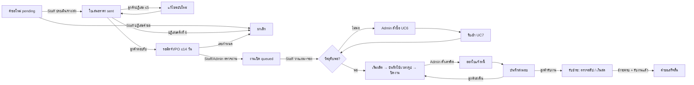

# Staff/Admin redesign — plan and handoff

Status date: 2026-10-30 · Branch `develop` · Last code commit `64548f1` (Step 3)

This document holds the complete owner-approved plan for the Staff/Admin redesign (audit, navigation, flow, design system, page specifications and step plan) and the current implementation status. Part A is status; Part B is the plan as approved.

---

# Part A — Status

## Goal and constraints

Redesign every Staff and Admin page to be simpler, Thai-language and easier to use.

- Keep every API call, payload, status value, permission and retry behavior unchanged. Only layout, wording and navigation change. Do not change statuses, calculations, permissions or data.
- Keep brand colors and the existing drawer pattern, Thai labels, and existing behavior.
- Do not touch the Overview page (ภาพรวม) content for either role; new pages match its style.
- No new libraries without asking. Do not invent features; anything the documents do not define is raised as a question.

## Owner decisions

| # | Topic | Decision |
| --- | --- | --- |
| 1 | Language | All Staff/Admin text in Thai; codes such as INV-1, PO, MO-… stay as they are |
| 2 | Counts | Load every record through existing endpoints, 100 per call, up to 1,000 per list; warn when a list is over 1,000. No backend change |
| 3 | Material plan names | Show material name and unit instead of IDs |
| 4 | Plan location | The material plan moves into the production job (same API) |
| 5 | Production order | Sort by the customer-requested date, clearly labelled as not a shop promise |
| 6 | Missing pages | No customers, reports or settings pages for now |
| 7 | Bulk actions | None |
| — | Design system + งานผลิต spec | Approved. Defaults taken: readiness on queue cards; fill buttons only fill fields (Staff still confirms each save); prioritized list, not a board |
| — | คำขอและใบเสนอราคา spec | Approved. Defaults taken: customer name “To be defined”; minimum price requested automatically; six stage tabs; one send button that saves first |
| — | Remaining pages | “approve all the pages” |
| — | Implementation plan | “go” |

Assumptions taken after “go” (the owner did not answer these two questions):

- The local database stays read-only. Saves are verified only with intercepted (fake) API responses during browser walks.
- The shared sidebar and bell also wrap the Overview page; Overview content is unchanged.

## Completed and pushed

| Commit | Purpose |
| --- | --- |
| `38a3d8e` | Customer invoice list and payment detail redesign (before the Staff/Admin work) |
| `6a6eb07` | Step 0: Thai workflow-grouped Staff/Admin sidebar with separate Admin section; notification bell with unread count and dropdown (`workspace-bell.tsx`, `workspace-notifications.ts`) |
| `d64f659` | Step 1: shared kit `src/components/staff-ui/`, `--success` token, Thai `MaterialPicker`, rebuilt งานผลิต |
| `7755318` | This handoff document (first version) |

Step 1 verification: Chrome walks as `anan.staff`, `kittipong.staff` and `pim.admin` at 1280px Dark and 390px Light with every write intercepted (correct payloads and versions, no overflow, no console errors); 163 native tests, type check, lint, source audit, build, DESIGN sync check and `git diff --check`.

Implemented differences from the spec, all within the approved intent:

- The bell links each notification to the role's request page with `?request=`.
- The งานผลิต toolbar is two rows (tabs, then search and อัปเดตข้อมูล) so it fits at every width.
- Drawers (side panels) are not used yet; create/edit drawers arrive with Steps 3, 4 and 7.

## Step 2 — คำขอและใบเสนอราคา (done)

| Commit | Purpose |
| --- | --- |
| `1313244` | Shared list/detail layout `staff-layout.module.css` (production imports it; sticky submit bar on phones); status-tab fix for a 421px phone overflow; request/quotation/evidence label maps; `dueDayCountdown` |
| `d07991e` | `src/features/requests/`: `request-stage-domain.ts` (stage, counts, sorting, checklist, minimum-price check) with 9 tests, `request-index.ts` (open requests read six at a time), `staff-requests.tsx` (six tabs, `?stage=&q=&request=`), `request-detail.tsx`, `request-quote.tsx`, `request-evidence.tsx`, `requests.module.css`; DESIGN.md and sync registration |

- Staff/Admin use the new `staff-requests.tsx`; Customer keeps `requests.tsx`, which still imports `quotations/quotations.tsx` → `fulfillment/fulfillment.tsx`. Those two files are therefore not deleted (the earlier note to delete them is withdrawn).
- Verification: 172 tests, type check, lint, source audit, DESIGN sync, build; Chrome walk as `anan.staff` and `pim.admin` at 1280px and 390px, Light and Dark, writes intercepted, งานผลิต re-walked. Not walked: 360, 768, 1920px.

## Step 3 — สต๊อกวัตถุดิบ + ข้อมูลหลัก (done)

| Commit | Purpose |
| --- | --- |
| `2067a65` | Shared `Toast` keeps its 5-second timer across page re-renders (affected every redesigned page) |
| `64548f1` | `src/features/inventory/`: `inventory.tsx` (view tabs, filter chips `?filter=`, table/cards, `?material=` side panel), `inventory-material.tsx` (quantities, movement history, Admin stock step form), `inventory-catalog.tsx` (units, materials, create/edit in the side panel), `inventory.module.css`; `stockCounts`/`filterStock`/`stockAfter`/`isBelow` with tests; shared `Drawer` and `MOVEMENT_MODE`; `MaterialSearch` moved to `material-search.tsx` |

- ข้อมูลหลัก is the `?view=catalog` tab of the page; it is not a sidebar item (B2 shows one; adding it needs a query-string nav link type).
- Verification: 174 tests and all checks; Chrome walk Admin 360/390/768/1280/1920, Staff 390/1280, Light and Dark, writes intercepted. Not exercised against the live API: saves, conflicts, retry.

## Working notes

- Every step: tests, type check, lint, `npm run audit:source` (unused exports fail), build; `src` `.ts`/`.tsx` files must stay at 310 lines or fewer; update DESIGN.md in the same step; commit and push per step.
- New CSS Module rules are prefixed with `:global(.live-workspace)` so they win over legacy workflow styles.
- Browser walks use local CDP scripts that log in through the local-test demo buttons and navigate with `window.next.router.push` (the session is memory-only). In Git Bash, run with `MSYS_NO_PATHCONV=1`. Dev server on :3000, backend on :8080.
- Next.js Cache Components keep the previous route mounted but hidden, so a second hidden `.app-shell` can exist in the DOM. This is expected.

## Open question

- Customer name on Staff/Admin request cards is “To be defined”: Staff receive only `customer_id`, and no endpoint returns the customer's name to Staff.

---

# Part B — Approved plan

## B1. Audit (before the redesign)

Sources: `docs/02-frontend.md`, the UC docs, the code and live screenshots as `anan.staff`.

### What each role could do

| Page (URL) | Staff | Admin |
| --- | --- | --- |
| ใบเสนอราคา `/staff/quotations` / คำขอผลิต `/admin/requests` (same screen, different names) | Request queue, refuse a request, create/edit/send quotations (sees costs), review Deposit/PO | Read requests and quotations, review Deposit/PO |
| สต๊อกวัตถุดิบ `/…/materials` | Search stock; plan and reserve materials for queued jobs | Units, materials, stock adjustments, average cost; job plans read-only |
| สั่งซื้อวัตถุดิบ `/admin/orders` | — (URL redirects to receiving) | Suppliers and supplier orders (UC6) |
| รับเข้าวัตถุดิบ `/…/receiving` | Record receipts and damaged goods | Plus supplier credit days and settlement |
| งานผลิต `/…/production` | Start job, record material use, labor minutes, photos; complete job | Monitor; enter labor cost and see actual cost |
| ส่งมอบและรับชำระ `/…/delivery-payment` | Issue invoice, record shipment | Plus credit terms, cash receipts, payment review |
| จัดการพนักงาน `/admin/workers` | — | Create and edit Staff accounts and passwords |
| การแจ้งเตือน `/…/inbox` | ✓ | ✓ |

- Redirect-only URLs: `/staff/requests`, `/staff/orders`, `/staff/delivery`, `/staff/payments`, `/staff/debtors`.
- Pages that do not exist: customers page, separate suppliers page (suppliers sit inside สั่งซื้อวัตถุดิบ), role management, settings (only a theme toggle), reports (the Overview chart is the only reporting). Admin cannot create other Admins (UC12 not supported).

### Problems on every page

1. English and developer wording on a Thai product (“Retry identical stock adjustment”, “uncertain response”, “ICT”, “189 bytes”); raw status codes (“ongoing”, “approved”); UUID fragments as record IDs.
2. Actions buried: one long column per detail page; long rule paragraphs before forms; 6+ “Refresh …” buttons on a page.
3. Lists cannot answer “what needs me now”: no status tabs or counts, only Previous/Next paging; search only on stock.
4. Hard to identify records: production list shows “Request c650ec78” instead of number and description; material plan lists IDs with no names.
5. Tables scroll sideways inside cards even at 1280px, worse on phones.
6. Inconsistent patterns: bell is a plain link with no unread count; confirmations use browser popups.

### Page-by-page problems and fixes

| Page | Role | Main problems | Fix |
| --- | --- | --- | --- |
| ใบเสนอราคา / คำขอผลิต | Staff, Admin | One screen with two names; request, files, quote, Deposit/PO, job and plan stacked in one ~4,000px column; next step not visible | One name “คำขอและใบเสนอราคา”; status tabs; detail = summary + one next-action card + step sections; plan moves to production |
| Deposit/PO review | Staff, Admin | Three levels deep; waiting items invisible | “รอตรวจหลักฐาน” tab; approve/reject beside the file |
| สต๊อกวัตถุดิบ | Staff, Admin | Stock, admin catalog forms and job plans on one page; every material is a card with “Open” | Scannable table/list with search; Admin catalog in its own “ข้อมูลหลัก” tab; stock adjustment in a drawer |
| Job material plan | Staff edit, Admin read | Appears in three places; IDs instead of names | One home: the “เตรียมวัตถุดิบ” step of a queued job, with names |
| สั่งซื้อวัตถุดิบ | Admin | Orders and suppliers mixed; long order form | Tabs ใบสั่งซื้อ / ผู้ขาย; new order is a short step form with a live total |
| รับเข้าวัตถุดิบ | Staff, Admin | Each line entered by hand; supplier payment mixed in | “รับครบตามที่สั่ง” fills remaining quantities, user confirms; Admin payment is a separate section |
| งานผลิต | Staff, Admin | Raw IDs; no priority; all forms open at once; tables overflow | Prioritized list (รอเริ่มงาน / กำลังผลิต / ผลิตเสร็จ); step flow เตรียมวัตถุดิบ → เริ่ม → บันทึกการใช้/เวลา/รูป → ปิดงาน; Admin costs in own panel |
| ส่งมอบและรับชำระ | Staff, Admin | Generic job list; terms, invoice, shipment, cash, review stacked | Tabs by state; only the action valid for that job's status |
| จัดการพนักงาน | Admin | Long create/edit form; password rules in English | List + drawer for create/edit; password change in its own small drawer |
| การแจ้งเตือน | Staff, Admin | Separate page; bell has no count | Bell with unread count and dropdown plus “ดูทั้งหมด” |

Hide or default:

- Hide UUIDs, version numbers and event logs in a collapsed “ประวัติระบบ”; rule paragraphs in a collapsed “เงื่อนไข” note.
- Replace per-section Refresh buttons with one “อัปเดตข้อมูล” per page.
- Keep the deposit amount pre-filled as today; credit days stay blank (no documented default).
- Paid-at time: proposed “ใช้เวลาปัจจุบัน” button rather than auto-fill.

## B2. Navigation (labels and grouping only; no URL changes) — implemented in Step 0

```
Staff                              Admin
ภาพรวม (unchanged)                 ภาพรวม (unchanged)
งานขาย                             งานขาย
  คำขอและใบเสนอราคา                  คำขอและใบเสนอราคา
การผลิต                            การผลิต
  งานผลิต                            งานผลิต
  สต๊อกวัตถุดิบ                       สต๊อกวัตถุดิบ
  รับเข้าวัตถุดิบ                     จัดซื้อ
ส่งมอบและการเงิน                       สั่งซื้อวัตถุดิบ · รับเข้าวัตถุดิบ
  ส่งมอบและใบแจ้งหนี้               ส่งมอบและการเงิน
                                     ส่งมอบและรับชำระ
🔔 in the navbar (unread count)     ── ผู้ดูแลระบบ ──
                                     จัดการพนักงาน · ข้อมูลหลัก (หน่วย/วัตถุดิบ)
```

ข้อมูลหลัก is planned as a tab of สต๊อกวัตถุดิบ (`?view=catalog`, Step 3), not a new route. การแจ้งเตือน leaves the sidebar and is reached through the bell.

## B3. Flow between pages



## B4. Shared design system (all Staff/Admin pages except Overview)

Look and feel (same as Overview): existing Dark/Light themes, orange accent, Noto Sans Thai, 16px-radius panels, 8-point spacing (8/16/24/32).

| Use | Size (px) |
| --- | --- |
| Page title | 28 |
| Section heading | 18 |
| Body text | 16 |
| Small info (dates, IDs) | 14 |
| Large numbers | 32 |

Touch targets: at least 44px; 48px for main buttons and fields.

| Component | Rule |
| --- | --- |
| Page header | Title, one-line purpose, at most one main button, and one “อัปเดตข้อมูล” button |
| Status tabs with counts | Same look as Customer lists; counts include every record; selected tab kept in the URL |
| Search and filter chips | One search box per list; filters are chips, not dropdowns |
| Status badge | Colored dot plus Thai text, never color alone; one shared wording map |
| Record card / row | Request number, description, status and next step; no UUIDs |
| Detail layout | Summary → next-action card (one main button) → step sections → collapsed “ประวัติระบบ” |
| Side panel (drawer) | Create/edit forms slide in from the side on desktop, full screen on phones |
| Step form | Numbered steps, live total or summary, field-level Thai errors |
| Confirmation dialog | In-page dialog stating what will happen; irreversible actions require ticking a checkbox first |
| Toast | Success disappears after 5 seconds; errors stay until closed |
| “Did it save?” panel | “ไม่แน่ใจว่าบันทึกสำเร็จหรือไม่” with [ส่งซ้ำแบบเดิม] [โหลดข้อมูลล่าสุด]; same retry behavior as before |
| Page states | Skeleton loading; empty with next step; error with [ลองอีกครั้ง]; “ไม่มีสิทธิ์”; warning over 1,000 records |
| Notification bell | Same as Customer: unread count, dropdown, “ดูทั้งหมด” |
| “เงื่อนไข” help note | Long rule paragraphs move into a collapsed help section |

| Color | Meaning |
| --- | --- |
| Grey | Waiting |
| Blue | In progress |
| Orange | You need to act |
| Green | Done |
| Red | Problem or cancelled |

Status wording reuses Customer labels (งาน: รอเริ่มงาน / กำลังผลิต / ผลิตเสร็จ / ยกเลิก; ใบแจ้งหนี้: ยังไม่ชำระ / ชำระบางส่วน / ชำระครบ). Staff-only statuses are mapped per page.

| Page type | Layout |
| --- | --- |
| Lists | Tabs + cards |
| Detail | Summary → next action → steps |
| Forms | Steps + live summary |
| Production | Prioritized queue |

Number display: quantities drop trailing zeros (`5.000000` → `5`) while stored values stay exact; minutes show as “1 ชม. 30 นาที”.

## B5. Page spec — งานผลิต (`/staff/production`, `/admin/production`) — implemented in Step 1

Purpose: Staff — “Which job do I do next, and how do I record work in a few taps?” Admin — monitor production and enter actual labor cost.

Desktop 1280px (list stays on the left; opening a job adds `?job=`):

```
┌ งานผลิต ─────────────────────────────────────────── [อัปเดตข้อมูล] ┐
│ เตรียมวัตถุดิบ เริ่มงาน และบันทึกการผลิตของแต่ละงาน                    │
│ [รอเริ่มงาน 3] [กำลังผลิต 1] [ผลิตเสร็จ 4] [ทั้งหมด 8]  🔍 เลขคำขอ/ชื่องาน│
├──────────────────────┬──────────────────────────────────────────────┤
│ ● คำขอ #7  รอเริ่มงาน │ คำขอ #7 · S45C bushings · 8 ชิ้น   ● รอเริ่มงาน │
│ S45C bushings · 8 ชิ้น│ ลูกค้าต้องการ 5 พ.ย. (อีก 7 วัน) · รอบผลิตที่ 1   │
│ ลูกค้าต้องการ 5 พ.ย.   │ ┌ ขั้นตอนถัดไป ─────────────────────────────┐ │
│ → เตรียมวัตถุดิบ       │ │ ① เตรียมวัตถุดิบ  ② เริ่มผลิต  ③ บันทึกงาน │ │
│──────────────────────│ │ วัตถุดิบจองครบแล้ว พร้อมเริ่มผลิต           │ │
│ ● คำขอ #9 กำลังผลิต   │ │                         [ เริ่มผลิต ]      │ │
│ ...                  │ └──────────────────────────────────────────┘ │
│                      │ วัตถุดิบของงานนี้ (ชื่อ · ตามแผน · จอง · ใช้ · คืน) │
│                      │ ▸ ประวัติงานนี้   ▸ ประวัติระบบ                  │
└──────────────────────┴──────────────────────────────────────────────┘
```

Phone 375px / tablet 768px (list and detail are separate screens; materials table becomes cards; main button fixed at the bottom; two columns from 1024px):

```
┌ งานผลิต      [⟳] ┐   ┌ ← กลับรายการ        ┐
│[รอเริ่ม 3][กำลัง 1]│   │ คำขอ #9 ● กำลังผลิต │
│[เสร็จ 4][ทั้งหมด]  │   │ Mold pins · 9 ชิ้น   │
│🔍 ค้นหา            │   │ เวลาทำงานรวม 2 ชม.   │
│┌───────────────┐ │   │[ใช้วัตถุดิบ][เวลา][รูป]│
││คำขอ #7 รอเริ่ม │ │   │ DEMO S45C (ชิ้น)     │
││S45C bushings  │ │   │ จองไว้เหลือ 4        │
││ต้องการ 5 พ.ย.  │ │   │ ใช้ครั้งนี้ [____]    │
││เตรียมวัตถุดิบ → │ │   │ [ใช้ตามที่จองไว้ 4]   │
│└───────────────┘ │   │ + เพิ่มวัตถุดิบนอกแผน │
└──────────────────┘   │[ บันทึกการใช้วัตถุดิบ ]│ ← fixed bottom
                       └─────────────────────┘
```

Components, fields and actions:

- List: tabs and counts from all jobs; each card matched to its request (request list loaded in full) for number, description and quantity. รอเริ่มงาน and กำลังผลิต sorted by the customer-requested date, undated last, labelled “ลูกค้าต้องการ” (never “กำหนดส่ง”); ผลิตเสร็จ newest first. Queue cards show material readiness (approved default).
- Detail summary: request number, description, quantity, status; requested date with “not a shop promise” note; production round (“รอบผลิตที่ 2 · แก้ไขฟรี” for rework); started/finished times; total labor.
- Next action (Staff):
  - รอเริ่มงาน: ① material plan editor (moved from สต๊อกวัตถุดิบ) with names and units, save plan and reserve; ② เริ่มผลิต, enabled only when fully reserved, behind a confirmation.
  - กำลังผลิต: “บันทึกงาน” with ใช้วัตถุดิบ (per planned material “ใช้ครั้งนี้”, [ใช้ตามที่จองไว้ (n)] fill, “+ เพิ่มวัตถุดิบนอกแผน” search, optional note), เวลา (minutes with +15/+30/+60, live “= 1 ชม. 30 นาที”, optional note), รูป (JPEG/PNG upload, camera on phones). “ปิดงาน” separate at the bottom; confirmation requires ticking “บันทึกวัตถุดิบครบแล้ว” and “บันทึกเวลาครบแล้ว”.
  - ผลิตเสร็จ: summary and link “ไปที่ส่งมอบและใบแจ้งหนี้ →”.
- Admin: no production buttons; “ต้นทุนจริง (เฉพาะ Admin)” panel with material, labor and total cost plus labor-cost form; history shows unit cost and amount.
- History (collapsed): one timeline of material use, labor, photos and events; versions and IDs only under “ประวัติระบบ”.

| Situation | Wording |
| --- | --- |
| Plan not ready | “ยังเริ่มผลิตไม่ได้ ต้องจองวัตถุดิบตามแผนให้ครบก่อน” |
| Start confirmation | “เริ่มผลิตงานนี้? แผนวัตถุดิบจะถูกล็อก และสต๊อกจะถูกตัดเมื่อบันทึกการใช้จริงเท่านั้น” → [เริ่มผลิต] [ยกเลิก] |
| Usage hint | “กรอกเฉพาะที่ใช้ตั้งแต่บันทึกครั้งล่าสุด ระบบใช้ของที่จองไว้ให้งานนี้ก่อน” |
| Usage saved | “บันทึกการใช้วัตถุดิบแล้ว” |
| Time saved | “เพิ่มเวลาทำงาน 30 นาทีแล้ว” |
| Photo saved | “แนบรูปงานแล้ว” |
| Close confirmation | “ปิดงานนี้? วัตถุดิบที่จองแต่ไม่ได้ใช้จะถูกคืน และจะบันทึกการใช้หรือเวลาเพิ่มไม่ได้อีก” |
| Closed | “ปิดงานแล้ว · ไปออกใบแจ้งหนี้และส่งมอบต่อได้” |
| Minutes error | “กรอกนาทีเป็นจำนวนเต็ม 1–1,000,000” |
| Usage error | “กรอกจำนวนที่ใช้อย่างน้อย 1 รายการ” |

| State | Shows |
| --- | --- |
| Loading | Skeleton cards, “กำลังโหลดงานผลิต…” |
| Empty (per tab) | e.g. “ยังไม่มีงานรอเริ่ม · งานจะเข้าคิวเมื่อมัดจำ/PO ผ่านการตรวจแล้ว” |
| Error | “โหลดงานผลิตไม่สำเร็จ” [ลองอีกครั้ง] |
| Over 1,000 jobs | Incomplete-count warning |
| Success | Toast; job reloads |
| Unsure whether saved | “Did it save?” panel |
| No permission | Existing guard; Admin never sees production buttons |

## B6. Page spec — คำขอและใบเสนอราคา (`/staff/quotations`, `/admin/requests`) — implemented in Step 2

Both URLs get the same name and screen; `/staff/requests` keeps redirecting.

Purpose: Staff — “Which requests need a quote from me, and whose Deposit/PO is waiting for my review?” Admin — read requests and quotations (with internal costs) and review Deposit/PO.

Stage tabs are views worked out from existing data, not new statuses. The page reads quotations and Deposit/PO for every active request, six at a time; finished and cancelled requests need no extra reads.

| Tab | Rule (existing data only) | Who acts |
| --- | --- | --- |
| ต้องทำใบเสนอราคา | Request active, and no quotation, only a draft, or the latest quotation rejected | Staff 🟠 |
| รอลูกค้าตอบ | Latest quotation `sent` | Customer |
| รอมัดจำ/PO | Quotation `approved`, no job yet, nothing waiting for review | Customer |
| รอตรวจหลักฐาน | Quotation `approved`, some evidence `pending`, no job yet | Staff/Admin 🟠 |
| เปิดงานแล้ว | Deposit/PO record has a job | — |
| ปิดแล้ว | Request `completed` or `canceled` | — |

The page opens on the first 🟠 tab with items (or the linked request's tab). 🟠 tabs show an orange dot on the count; Admin does not get the dot on ต้องทำใบเสนอราคา.

Desktop 1280px (selected request in `?request=`):

```
┌ คำขอและใบเสนอราคา ─────────────────────────────── [อัปเดตข้อมูล] ┐
│ ประเมินราคา ส่งใบเสนอราคา และตรวจหลักฐานมัดจำ/PO                    │
│ [ต้องทำใบเสนอราคา ●2][รอลูกค้าตอบ 1][รอมัดจำ/PO 2][รอตรวจหลักฐาน ●1]│
│ [เปิดงานแล้ว 5][ปิดแล้ว 3]               🔍 เลขคำขอ/รายละเอียดงาน      │
├──────────────────────┬──────────────────────────────────────────────┤
│ คำขอ #1   รอประเมิน   │ คำขอ #1 · Rubber mold insert · 2 ชิ้น          │
│ Rubber mold insert   │ ส่งเมื่อ 29 ต.ค. · ลูกค้าต้องการ 11 พ.ย.         │
│ 2 ชิ้น · ส่ง 29 ต.ค.   │ วัสดุ: S45C · ไฟล์แบบ 2 ไฟล์ [เปิด]             │
│ → ทำใบเสนอราคา        │ ┌ ① ทำใบเสนอราคา ─────────────────────────┐ │
│──────────────────────│ │ ค่าวัตถุดิบรวม [ 1,000.00 ]               │ │
│ คำขอ #2   ร่าง        │ │ ค่าแรงรวม     [   500.00 ]               │ │
│ ...                  │ │ ราคาขั้นต่ำ (ระบบคำนวณ) 2,400.00 บาท      │ │
│                      │ │ ราคาเสนอลูกค้า [ 2,500.00 ]  ✓ ไม่ต่ำกว่าขั้นต่ำ│ │
│                      │ │ [บันทึกร่าง]          [ ส่งใบเสนอราคา ]   │ │
│                      │ └──────────────────────────────────────────┘ │
│                      │ ▸ รับงานไม่ได้? ปฏิเสธคำขอ                       │
│                      │ ▸ ประวัติใบเสนอราคาและการตัดสินใจของลูกค้า       │
└──────────────────────┴──────────────────────────────────────────────┘
```

Phone 375px / tablet 768px (list and detail separate; tabs scroll inside their own row; main button fixed at the bottom):

```
┌ คำขอและใบเสนอราคา [⟳]┐  ┌ ← กลับรายการ           ┐
│[ต้องทำ ●2][รอตอบ 1]→ │  │ คำขอ #5 ● รอตรวจหลักฐาน │
│🔍 ค้นหา               │  │ ราคาที่ตอบรับ 6,400.00  │
│┌──────────────────┐ │  │ ส่งหลักฐานภายใน 12 พ.ย. │
││คำขอ #5 รอตรวจหลักฐาน│ │  │ (อีก 13 วัน)            │
││Custom shaft · 6 ชิ้น│ │  │┌ สลิปมัดจำ ●รอตรวจ ───┐│
││ยอดแจ้ง 3,200.00    │ │  ││แจ้งยอด 3,200.00      ││
││ตรวจหลักฐาน →       │ │  ││โอนเมื่อ 30 ต.ค. 10:12 ││
│└──────────────────┘ │  ││[เปิดไฟล์]             ││
└─────────────────────┘  ││(●) อนุมัติ ( ) ไม่อนุมัติ││
                         ││☐ ตรวจไฟล์แล้ว          ││
                         │└──────────────────────┘│
                         │[ ยืนยันผลการตรวจ ]      │ ← fixed bottom
                         └────────────────────────┘
```

Components, fields and actions:

- Request card: number, description (2 lines), quantity, sent date, customer's requested date if given, stage badge and next step (“→ ทำใบเสนอราคา” / “→ ตรวจหลักฐาน” / “รอลูกค้า”). Customer name: To be defined.
- Detail summary: number, description, quantity, material spec, sent date, requested date; request files with [เปิดไฟล์] (same private download); customer type (บุคคล/บริษัท) after acceptance; rejection counter “ลูกค้าปฏิเสธแล้ว 2 ครั้ง · ครั้งที่ 6 จะยกเลิกคำขอ” from the server count.
- One next-action card per stage:
  1. ทำใบเสนอราคา (Staff only; new, draft, or new revision after rejection): ค่าวัตถุดิบรวม, ค่าแรงรวม, ราคาเสนอลูกค้า. Minimum price requested automatically from the existing estimate endpoint once both costs are valid (the browser never calculates it). Inline checks “ราคาเสนอต่ำกว่าราคาขั้นต่ำ …” (against the server figure) and “กรอกตัวเลข ทศนิยมไม่เกิน 2 ตำแหน่ง”. Live summary marked “ไม่มี VAT”. [บันทึกร่าง] secondary; [ส่งใบเสนอราคา] saves first if needed, then confirms; send API unchanged.
  2. รอลูกค้าตอบ: quotation summary and sent time; no buttons, “รอลูกค้าตัดสินใจ”.
  3. รอมัดจำ/PO: terms (deposit amount, PO required, accepted total); deadline countdown “ส่งหลักฐานภายใน 12 พ.ย. (อีก 13 วัน)”; checklist มัดจำ ☐ / PO ☐.
  4. รอตรวจหลักฐาน (Staff/Admin): one card per evidence item (deposit slip or PO, declared amount and time, [เปิดไฟล์]); approve/reject radios (replacing the dropdown) with a reason when rejecting; checkbox “ตรวจไฟล์แล้ว · การอนุมัติรายการสุดท้ายจะเปิดงานผลิต”.
  5. เปิดงานแล้ว: approved deposit, remaining balance, job opened date, [ไปงานผลิต →] (`…/production?job=…`). No material plan here.
- Secondary (collapsed): “รับงานไม่ได้? ปฏิเสธคำขอ” (only `pending`, required customer-visible reason); “ประวัติใบเสนอราคาและการตัดสินใจของลูกค้า”; “ประวัติระบบ” (IDs, versions).
- Admin: no quotation or refuse buttons; reads quotations with internal costs; reviews evidence.

| Situation | Wording |
| --- | --- |
| Send confirmation | “ส่งใบเสนอราคา 2,500.00 บาท ให้ลูกค้า? ส่งแล้วแก้ไขไม่ได้ ถ้าลูกค้าปฏิเสธจะทำฉบับใหม่ได้” → [ส่งใบเสนอราคา] [กลับไปแก้ไข] |
| Sent | “ส่งใบเสนอราคาแล้ว · ลูกค้าจะเห็นในระบบ” |
| Draft saved | “บันทึกร่างแล้ว” |
| Refuse request | Heading “ปฏิเสธคำขอนี้”; field “เหตุผล (ลูกค้าจะเห็นข้อความนี้)”; confirm “ปฏิเสธคำขอ? การปฏิเสธนี้ไม่นับเป็นการปฏิเสธใบเสนอราคาของลูกค้า” |
| Evidence approved | “อนุมัติหลักฐานแล้ว”; if it opens the job: “ครบแล้ว · เปิดงานผลิตแล้ว [ไปงานผลิต]” |
| Evidence rejected | “ไม่อนุมัติหลักฐานแล้ว · ลูกค้าจะเห็นเหตุผลและส่งใหม่ได้ก่อนครบกำหนด” |
| Edit conflict | “มีคนแก้ไขใบเสนอราคานี้ไปแล้ว โหลดข้อมูลล่าสุดก่อนแก้ต่อ” [โหลดข้อมูลล่าสุด] |
| Past deadline | “เลยกำหนดส่งหลักฐานแล้ว · หลักฐานที่ส่งทันเวลายังตรวจได้ ระบบจะยกเลิกคำขอเองถ้าเอกสารไม่ครบ” |

| State | Shows |
| --- | --- |
| Loading | Skeleton cards; counts “…”; “กำลังตรวจสถานะคำขอ…” |
| Empty ต้องทำใบเสนอราคา | “ไม่มีคำขอที่รอใบเสนอราคา · คำขอใหม่จากลูกค้าจะเข้ามาที่นี่” |
| Empty รอตรวจหลักฐาน | “ไม่มีหลักฐานรอตรวจ” |
| One request unreadable | Card shows “ยังโหลดขั้นตอนล่าสุดไม่ได้ [ลองอีกครั้ง]”, counted separately, not hidden |
| Error | “โหลดคำขอไม่สำเร็จ” [ลองอีกครั้ง] |
| Over 1,000 | Incomplete-count warning |
| No permission | Existing guard; Admin never sees Staff-only buttons |

## B7. Implementation plan (one page per step)

Rules for every step:

- Unchanged: every API call, payload, status value, permission and retry behavior.
- All wording Thai; status words from one shared label list; codes (INV-1, PO, MO-…) unchanged.
- Accurate counts: existing endpoints, 100 at a time, up to 1,000, warning beyond.
- Overview untouched.
- Checks: type check, ESLint, `npm test` (new tests for tab/count logic), source audit, production build, DESIGN.md sync check, `git diff --check`; Chrome walk as `anan.staff` and `pim.admin` on the local API at 360, 768, 1280 and 1920px in both themes (no horizontal scroll, no console errors).
- Each step ends with its own verified commits pushed to `develop` and updates DESIGN.md in the same step.

| Step | Scope | Status |
| --- | --- | --- |
| 0 | Shared foundation: page header, status tabs with counts, status badge and Thai labels, record card, side panel and confirmation dialog, toast, “did it save?” panel, skeleton/empty/error states; number display rules; grouped sidebar with Admin section and the shared “คำขอและใบเสนอราคา” name; bell with unread count and dropdown (การแจ้งเตือน leaves the sidebar) | Done (`6a6eb07`; kit components in `d64f659`) |
| 1 | งานผลิต as approved; plan editor moves here with names and units; duplicate plans removed from สต๊อกวัตถุดิบ and the request detail | Done (`d64f659`) |
| 2 | คำขอและใบเสนอราคา as approved: six stage tabs (per-request quotation and Deposit/PO reads, six at a time), one action card, automatic minimum price, customer name To be defined | Done (`1313244`, `d07991e`) |
| 3 | สต๊อกวัตถุดิบ + ข้อมูลหลัก (see below) | Done (`2067a65`, `64548f1`) |
| 4 | สั่งซื้อวัตถุดิบ (Admin) (see below) | Not started |
| 5 | รับเข้าวัตถุดิบ (see below) | Not started |
| 6 | ส่งมอบและใบแจ้งหนี้ (Staff) / ส่งมอบและรับชำระ (Admin) (see below) | Not started |
| 7 | จัดการพนักงาน (Admin) (see below) | Not started |
| 8 | การแจ้งเตือน page (see below) | Not started |
| 9 | Wrap-up: handoff doc update, DESIGN.md consolidation, final full walk of every page for both roles | Not started |

Step 3 — สต๊อกวัตถุดิบ + ข้อมูลหลัก:

- Stock tab: table on desktop, cards on phones; filter chips from real values only: มีของพร้อมใช้ / หมด (พร้อมใช้ = 0) / มีการจอง / ปิดใช้งาน. No “ใกล้หมด” chip (no reorder level in the data).
- Side panel: quantities and movement history with the four movement types below; costs shown to Admin only (UC5); Admin [ปรับสต๊อก] step form previewing “คงเหลือ 10 → 15” and blocking going below what is reserved.
- Admin ข้อมูลหลัก tab (`?view=catalog`, no new route): units and materials (create, rename, activate); note that a material's unit cannot be changed and nothing can be deleted.

| Movement type | Thai label |
| --- | --- |
| `addition` | เพิ่มสต๊อก |
| `correction` | แก้ยอดตามที่นับ |
| `purchase_receive` | รับจากผู้ขาย |
| `job_issue` | เบิกใช้ในงาน |

Step 4 — สั่งซื้อวัตถุดิบ (Admin):

| Tab | Status |
| --- | --- |
| รอผู้ขายตอบ | `ordered` with supplier response `pending` |
| ผู้ขายรับแล้ว | response `accepted` |
| รับบางส่วน | `partially_received` |
| รับครบ | `received` |
| ยกเลิก | `cancelled` |

- Order detail: one action — accept/reject the supplier's response, or cancel with a reason.
- New order in a side panel: ① supplier and expected date; ② materials with a live estimated total (via `MaterialPicker`; remove `MaterialSearch`); ③ related jobs (optional).
- ผู้ขาย tab: list plus a side panel to add or edit suppliers.

Step 5 — รับเข้าวัตถุดิบ:

- Tabs: รอรับของ / รับบางส่วน / รับครบ / มีของเสียหาย (claims `pending_claim`/`claimed`) / Admin only: ค้างจ่ายผู้ขาย (from `payment_status`).
- Lines show ordered / received / remaining, with “รับครบตามที่เหลือ” fill buttons per line and for all lines; Staff still press save.
- Admin credit days and settlement become their own section.

Step 6 — ส่งมอบและใบแจ้งหนี้ (Staff) / ส่งมอบและรับชำระ (Admin):

- Tabs worked out from the existing action rules: รอตั้งเครดิต (Admin) / รอออกใบแจ้งหนี้ / พร้อมส่ง / รอลูกค้าตรวจรับ / รอตรวจการชำระ (Admin) / ค้างชำระ / ปิดแล้ว.
- Detail: large balance at the top (like the Customer invoice page), one action card for what the role can do next, payment-proof cards with the file, and a timeline.

Step 7 — จัดการพนักงาน (Admin):

- Searchable list plus a side panel to create or edit a Staff member, in sections ข้อมูล / ติดต่อ / รหัสผ่านเริ่มต้น.
- Password change in its own small side panel.
- A confirmation warns that changing a username logs that person out everywhere.

Step 8 — การแจ้งเตือน page:

- The “ดูทั้งหมด” page behind the bell gets the same Thai list style.

Step 9 — Wrap-up:

- Update this handoff, consolidate DESIGN.md, and do a final full walk of every page for both roles.
